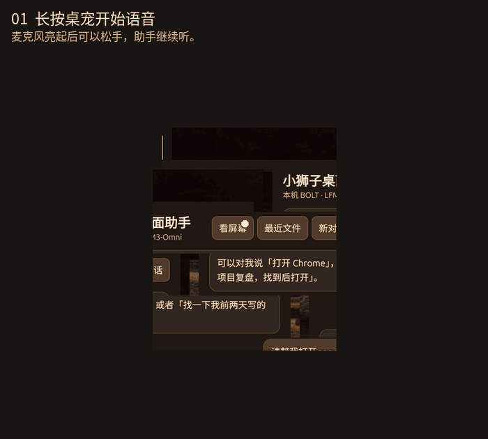

# 小狮子桌面助手 · Lion Desktop Assistant

一个运行在 Linux X11 桌面上的本地 3D 助手。双击小狮子打开文字面板，左键按住约半秒开始语音。松手后仍可继续说，检测到约 2.4 秒安静后发送，单段最长约 30 秒。语音在小狮子旁显示状态并播报，双击可以查看对话和确认卡。

## 实际操作演示



演示了长按录音、语音打开 Chrome、双击打开助手面板，以及预览、确认并批量移动两张图片。使用合成测试语音和专用测试图片，GIF 中以字幕标记语音和播报阶段。

## 已实现

| 场景 | 能力 |
| --- | --- |
| 应用和窗口 | 打开 Chrome、应用、网页和目录；列出、切换、正常关闭指定窗口 |
| 本地文件 | 查看近七天文件、按标题或部分正文查找、打开文件、新建目录、移动或批量移动图片 |
| 阅读和整理 | 读取文档摘录、跨文件提取待办、标注来源、确认后保存 Markdown 笔记 |
| 读屏和桌面操作 | 通过本地模型理解截图；查询系统状态和无障碍控件；确认后进行指定键鼠操作 |
| 桌宠 | 实时 3D 毛发、眼神和表情、拖动与视角旋转、三段改编舞蹈 |

确认卡显示目标窗口或文件路径。关闭窗口走系统正常关闭流程，应用可以要求保存。批量移动最多 20 张图片，限同一文件系统，目标同名时保留原文件。找文档以本机允许目录为范围，PDF 等格式只读取部分正文。视觉识别可能误读小字，点击坐标需要来自用户或应用的无障碍控件。

## 代码和模型

| 目录 | 负责什么 |
| --- | --- |
| [desktop/](desktop/) | Electron、Three.js、桌宠手势、面板、PipeWire/PulseAudio 录音 |
| [bolt/assistant/](bolt/assistant/) | 对话、工具路由、确认、审计和 X11 桌面桥，含 BOLT 网页界面 |
| [omni/](omni/) | LFM3-Omni 本地转写、语音合成、读屏推理服务 |
| [compose.yaml](compose.yaml) | llama.cpp CUDA、BOLT、语音容器配置 |
| [docs/PRD.md](docs/PRD.md) | 产品范围、交互和验收 |

```text
文字 ─────────────────────→ BOLT 助手 :18082
语音 → LFM3-Omni :18682 ──→ BOLT 助手
                                 ├→ llama.cpp :18080 → Nemotron Bolt
                                 └→ Unix socket → 桌面桥 → X11 / 本地文件
语音回复 ← LFM3-Omni :18682 ←── 执行结果
```

- **Nemotron 3.5 Bolt E4B** 使用 Q4_K_M GGUF，约 5.8 GiB，运行在 llama.cpp CUDA 13 容器。 [固定模型版本](https://huggingface.co/nvidia/NVIDIA-Nemotron-3.5-Bolt-E4B-4GB/tree/1db54d5b12533ff1bcaa8e42cf4c667988a1f1be)
- **LFM3-Omni-2B** 使用 BF16 主权重和音频编解码器，合计约 4.48 GB。服务直接用 PyTorch 和 Transformers 5.20.2 推理。 [模型主页](https://huggingface.co/LiquidAI/LFM3-Omni-2B)

权重从上游获取并在本机校验，推理时只读挂载。三个 HTTP 端口绑定回环地址，实际桌面操作由当前用户运行的桌面桥完成。项目会在本地保留审计记录和最近的用户请求截图。

## 本机启动

实测环境是 Linux x86_64、GNOME/X11、RTX 4090 24 GB。需要 NVIDIA 驱动、Docker Compose 和 NVIDIA Container Toolkit、Node.js/npm，以及宿主机上的 Python 3、Pillow、GTK/AT-SPI、X11/XTest、`pactl`、`parec`、`gio` 和 `pdftotext`。桌面桥需要从实际登录的 X11 会话启动。Chrome 和文档查看器由系统提供。

### 1. 准备模型和前端依赖

在已有环境中，可以将 `.env.example` 复制为 `.env`，填入两个现有模型目录，免去重复下载。新环境可运行：

```bash
python3 -m venv .venv
.venv/bin/pip install huggingface_hub
.venv/bin/python scripts/download-models.py
npm --prefix desktop ci
```

两套权重合计约 10 GB，Docker 镜像还需要额外空间。第一次构建需要下载容器镜像和依赖。

### 2. 启动桌面桥和模型服务

在已登录的桌面终端启动桌面桥并保留该终端：

```bash
./scripts/desktop-bridge.sh
```

在另一个终端启动容器：

```bash
./scripts/services.sh up -d --build
curl -fsS http://127.0.0.1:18082/api/health
curl -fsS http://127.0.0.1:18682/api/status
```

已有旧版服务运行时会占用相同端口。选择一套后端使用，或者只启动新版前端连接已有后端。

### 3. 启动小狮子

```bash
npm --prefix desktop start
```

有些 Linux 环境禁止 Electron 建立用户命名空间。如果启动日志明确提示 Chromium 沙箱不可用，可在信任本地源码的开发环境用 `(cd desktop && ./node_modules/.bin/electron --no-sandbox --ozone-platform=x11 .)` 复跑。该参数关闭 Chromium 沙箱。

## 开发和验证

开发从透明常驻 3D 窗口开始，随后复用 BOLT 桌面助手和 LFM3-Omni，加入带确认的文件与窗口操作。最后针对高分屏的点击丢失和录音提前结束，改用 X11 指针追踪和松手后的静音检测。

原运行版在本机实测了语音打开 Chrome、按正文找到并打开文档、多份周报汇总写入、批量移动冲突保护、正常关闭窗口及保存提示，以及录音越过原 12 秒上限和松手后继续说话。仓库整理版的验证范围见 [发布检查](docs/RELEASE.md)。

## 发布范围

仓库包含源码、锁文件、部署配置和文档。模型权重、Electron 二进制、真实录音、日常截图、会话及审计日志由本机环境保存。README 仅包含用测试内容录制的演示。模型和第三方依赖使用各自的上游许可，项目源码的发布许可证由维护者确定。
